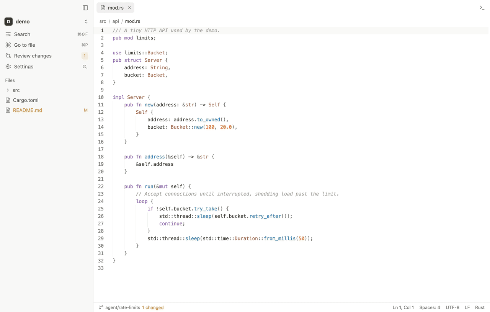
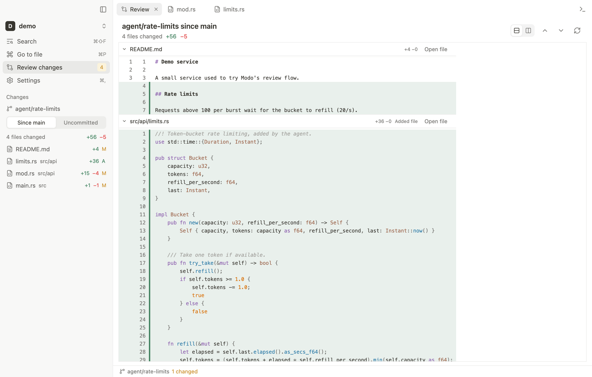
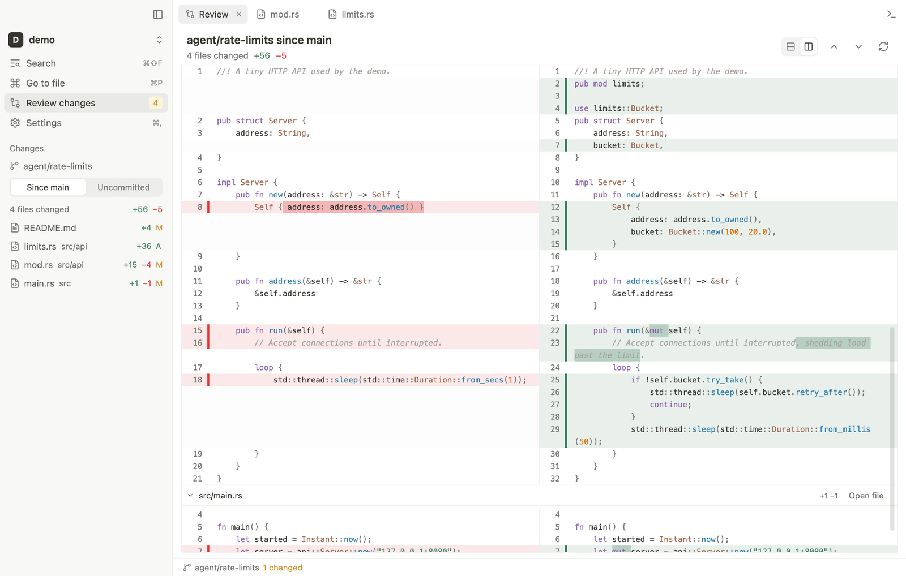
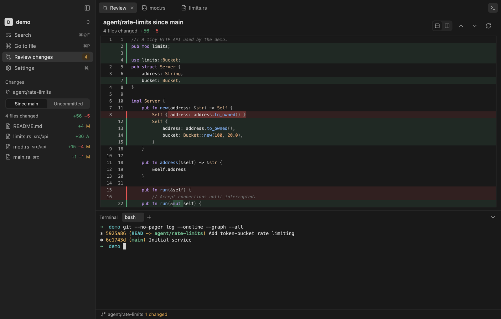
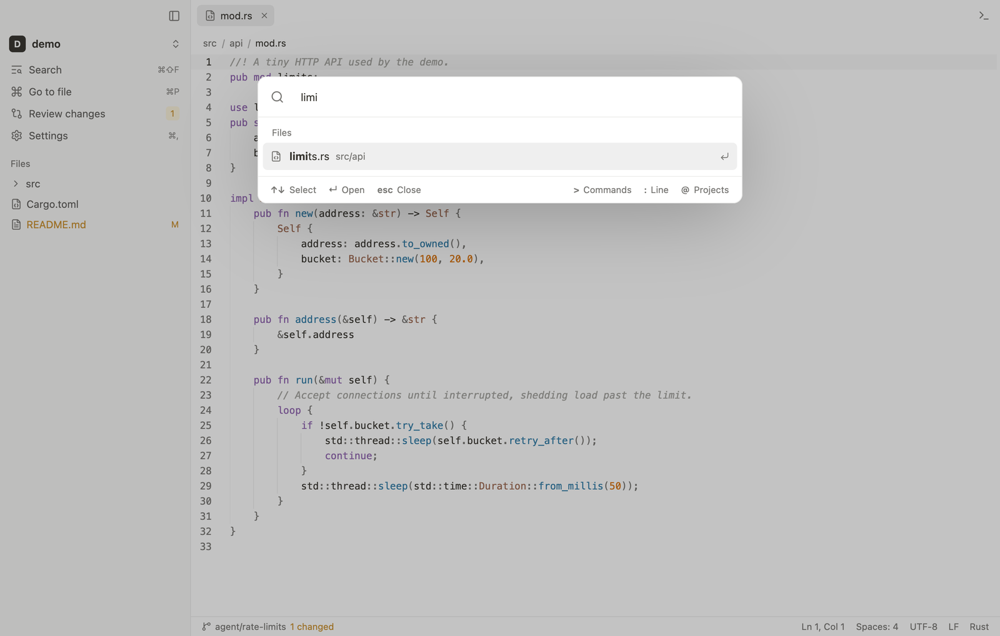
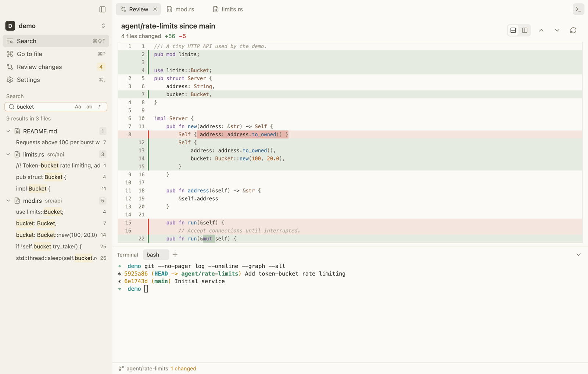
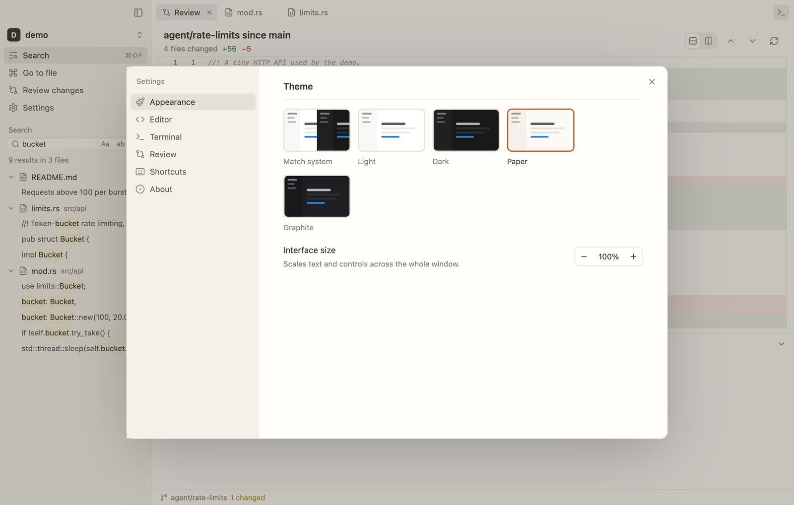

<p align="center">
  
</p>

<h1 align="center">Modo</h1>

<p align="center">A fast, quiet desktop app for reading, reviewing, and editing the code your agents wrote.</p>

<p align="center">
  
</p>

Agents like Claude Code, Codex, and Cursor write most of the code now. What you need afterwards is a place to see what changed, read it comfortably, fix a line, and run a command. Modo is that place: a native app with no extensions, no language servers, and no background indexer, so it opens in a blink and stays out of your way.

## What it does

- **Review agent work.** One scrollable diff of everything a branch changed since `main` (or any branch you pick), or only what is uncommitted. Unified or side by side, syntax highlighted, word-level changes marked. Switch between git worktrees in one click.
- **Read and edit code.** Tree-sitter highlighting for over 25 languages, find and replace, multiple cursors, safe saves that never overwrite changes made on disk.
- **Create and save files.** Use the Files toolbar or right-click a folder to create a file. Auto save saves after a short typing pause; turn it off in Settings > Editor when you prefer manual saves.
- **Follow along live.** Files, the tree, and the review refresh on their own while an agent edits.
- **Inspect structured data.** JSON opens as an expandable tree and CSV/TSV as a table. Search keys, values, or cells with `⌘F` / `Ctrl+F`; use **Source** to edit and **Format** (Alt+Shift+F) to tidy the document. Formatting is undoable and preserves JSON number precision and duplicate keys, and CSV cell contents. Native rows are virtualized; parsing and search run in the background. Structured views support up to 10 MiB and 250,000 values, with source editing available when a preview exceeds the value limit.
- **Find anything.** Fuzzy file search, project-wide search on ripgrep's engine, and a command palette.
- **Run commands.** A real terminal with tabs, nested horizontal and vertical splits, a full-window mode, true color, and the shell you choose: zsh, bash, fish, PowerShell, Command Prompt, Git Bash, WSL, or your own command.
- **Look calm.** Light, Dark, Paper, Graphite, Midnight, and Black themes, with optional project gradients across the app to distinguish workspaces.

- **Track your review.** Select an individual commit or compare a branch, then mark each changed file reviewed from its diff header or the sidebar. Checkmarks survive restarts and clear when the diff changes.
- **Track source tasks.** The To-dos sidebar finds TODO, FIXME, BUG, HACK, NOTE, and XXX comments. Filter by tag, jump to a source line, or mark tasks completed.
- **Keep projects tidy.** Ignored files are hidden by default; Settings > Appearance can show them greyed out. Right-click a tab for bulk closing options. Click the folder name for recent folders and new-window options.

## Install

Download a build from the [Releases page](https://github.com/yesabhishek/modo/releases):

| Platform | File | Notes |
| --- | --- | --- |
| macOS 12+ | `modo-<version>-macos-universal.dmg` | Drag Modo to Applications. See the first-launch note below. |
| Windows 10+ | `modo-<version>-windows-x64-setup.exe` | Installs for your user only. Adds "Open with Modo" to folders. If SmartScreen appears, choose More info > Run anyway. |
| Ubuntu / Debian | `modo_<version>_amd64.deb` | `sudo apt install ./modo_<version>_amd64.deb` |
| Other Linux | `modo-<version>-linux-x86_64.tar.gz` | Extract, then put `modo` on your PATH. Runs on X11 and Wayland. |

**First launch on macOS.** Modo is not notarized by Apple, so macOS blocks the first launch. Open it once, then go to System Settings > Privacy & Security and click **Open Anyway**. Or run this once:

```bash
xattr -dr com.apple.quarantine /Applications/Modo.app
```

### Updates

Packaged installations check for a newer stable release in the background at startup and verify the download against its SHA-256 checksum. On macOS, updates replace the app bundle and take effect next launch; the previous bundle is restored if replacement fails. Windows waits until all Modo processes using the installation have exited, then runs the installer. Writable Linux installations replace the binary; protected system installations download a package and expose an install action in the status bar. Settings > About can disable automatic updates. Source builds and temporary sessions do not update themselves.

### From source

You need [Rust](https://rustup.rs) and Git. On Linux, also install the display libraries:

```bash
sudo apt install libxkbcommon-dev libxkbcommon-x11-dev libwayland-dev libx11-xcb-dev libxcb1-dev libfontconfig1-dev libfreetype6-dev libvulkan-dev
```

Then build and install for your user (macOS or Linux):

```bash
git clone https://github.com/yesabhishek/modo.git && cd modo
scripts/install.sh
```

On macOS this puts `Modo.app` in Applications and a `modo` command on your PATH. On Windows, run `pwsh scripts/package-windows.ps1` (needs [NSIS](https://nsis.sourceforge.io)) and use the installer it writes to `dist\`.

## Use it

Open a project from a terminal, or drop a folder on the app:

```bash
modo .
```

Then review what your agent did:

1. Press `⌘⇧G` (Ctrl+Shift+G) to open **Review**. It compares the branch with `main` by default; use the menu beside the branch name to compare with any other branch, or choose **Uncommitted changes** to see only local edits.
2. Click a file in the sidebar to jump to it. Double-click a line, or use **Open file**, to edit it.
3. Press `⌘J` (Ctrl+J) for a terminal to run tests or commit.

| Action | macOS | Windows / Linux |
| --- | --- | --- |
| Go to file | `⌘P` | `Ctrl+P` |
| Command palette | `⌘K` | `Ctrl+K` |
| Search in files | `⌘⇧F` | `Ctrl+Shift+F` |
| Review changes | `⌘⇧G` | `Ctrl+Shift+G` |
| File preview | `⌘⇧V` | `Ctrl+Shift+V` |
| Terminal | `⌘J` | `Ctrl+J` |
| Full-window terminal | `⌘⇧J` | `Ctrl+Shift+J` |
| Settings | `⌘,` | `Ctrl+,` |

In the palette, type `>` for commands, `:` for a line number, and `@` to switch projects.

## Screenshots

| | |
| --- | --- |
|  |  |
|  |  |
|  |  |

## Develop

```bash
cargo run -- path/to/project   # debug build
cargo test                     # unit and Git integration tests
cargo clippy --all-targets -- -D warnings
```

Modo is a native Rust application on [GPUI](https://gpui.rs), the GPU renderer behind Zed, with components from GPUI Kit. See [docs/ARCHITECTURE.md](docs/ARCHITECTURE.md) for how it fits together, [docs/PERFORMANCE.md](docs/PERFORMANCE.md) for measurements, and [docs/RELEASING.md](docs/RELEASING.md) for packaging. Contributions are welcome; start with [CONTRIBUTING.md](CONTRIBUTING.md).

## Publisher

[Abhishek Choudhury](https://www.abhishekchoudhury.com).

## License

MIT. Third-party licenses ship with each build in `THIRD_PARTY_NOTICES.md`.
