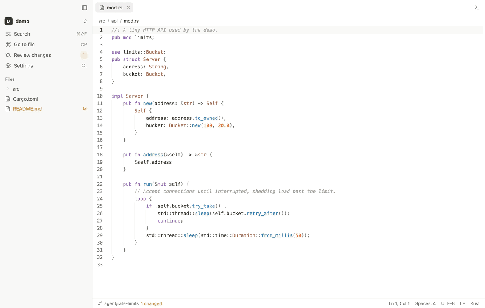
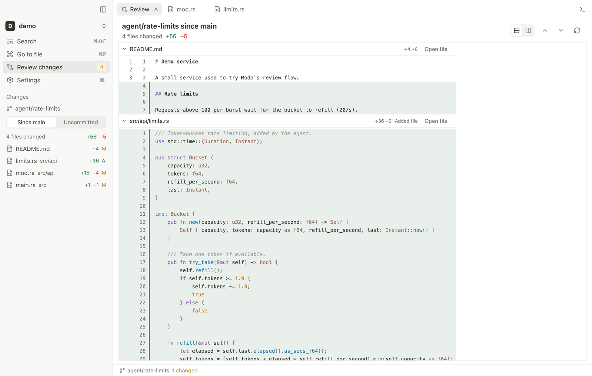
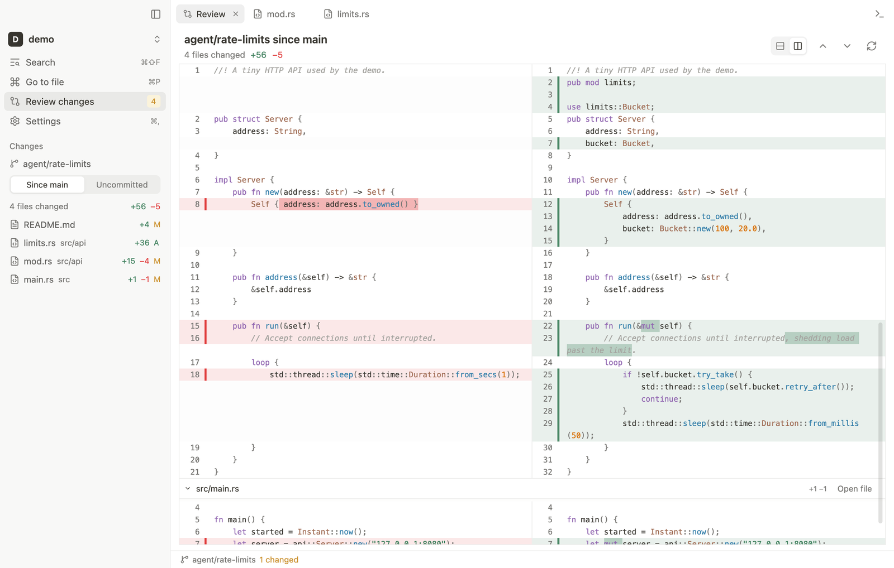
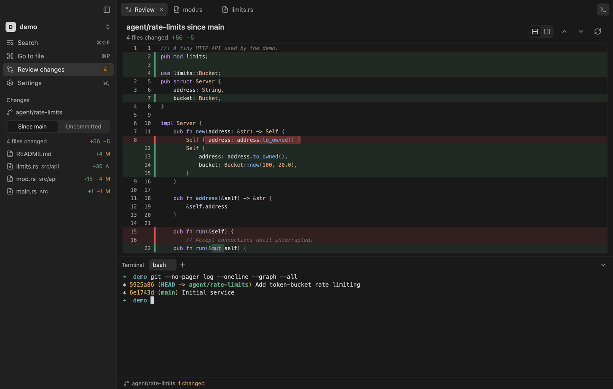
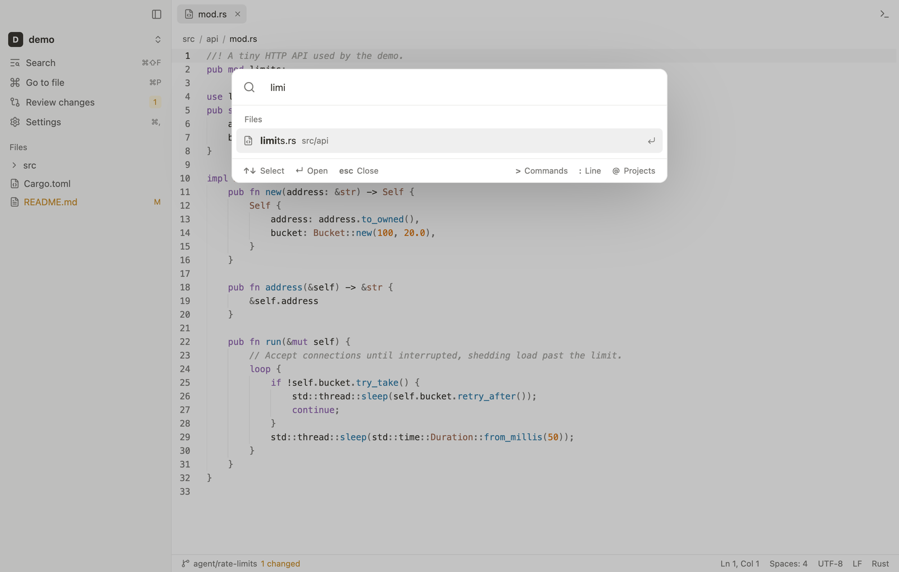
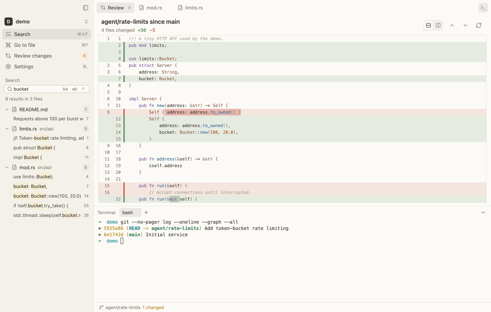
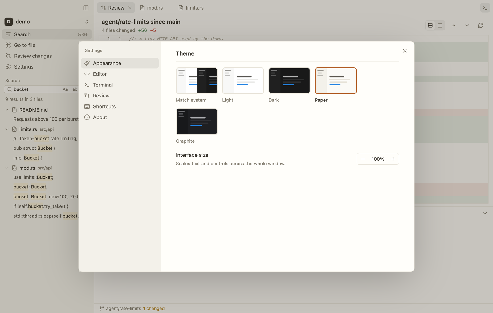

<p align="center">
  
</p>

<h1 align="center">Modo</h1>

<p align="center">A fast, quiet desktop app for reading, reviewing, and editing the code your agents wrote.</p>

<p align="center">
  
</p>

Agents like Claude Code, Codex, and Cursor write most of the code now. What you need afterwards is a place to see what changed, read it comfortably, fix a line, and run a command. Modo is that place: a native app with no extensions, no language servers, and no background indexer, so it opens in a blink and stays out of your way.

## What it does

- **Review agent work.** One scrollable diff of everything a branch changed since `main`, or only what is uncommitted. Unified or side by side, syntax highlighted, word-level changes marked. Switch between git worktrees in one click.
- **Read and edit code.** Tree-sitter highlighting for over 25 languages, find and replace, multiple cursors, safe saves that never overwrite changes made on disk.
- **Follow along live.** Files, the tree, and the review refresh on their own while an agent edits.
- **Find anything.** Fuzzy file search, project-wide search on ripgrep's engine, and a command palette.
- **Run commands.** A real terminal with tabs, true color, and your login shell.
- **Look calm.** Light, Dark, Paper, and Graphite themes, inspired by Notion.

## Install

Download a build from the [Releases page](https://github.com/yesabhishek/modo/releases):

| Platform | File | Notes |
| --- | --- | --- |
| macOS 12+ | `modo-<version>-macos-universal.dmg` | Drag Modo to Applications. See the first-launch note below. |
| Windows 10+ | `modo-<version>-windows-x64-setup.exe` | Installs for your user only. Adds "Open with Modo" to folders. |
| Linux | `modo-<version>-linux-x86_64.tar.gz` | Extract, then put `modo` on your PATH. Runs on X11 and Wayland. |

**First launch on macOS.** Modo is not notarized by Apple, so macOS blocks the first launch. Open it once, then go to System Settings > Privacy & Security and click **Open Anyway**. Or run this once:

```bash
xattr -dr com.apple.quarantine /Applications/Modo.app
```

### From source

You need [Rust](https://rustup.rs) and Git. On Linux, also install the display libraries:

```bash
sudo apt install libxkbcommon-dev libxkbcommon-x11-dev libwayland-dev libx11-xcb-dev libxcb1-dev libfontconfig1-dev libfreetype6-dev libvulkan-dev
```

Then build and install for your user (macOS or Linux):

```bash
git clone https://github.com/yesabhishek/modo.git && cd modo
scripts/install.sh
```

On macOS this puts `Modo.app` in Applications and a `modo` command on your PATH. On Windows, run `pwsh scripts/package-windows.ps1` (needs [NSIS](https://nsis.sourceforge.io)) and use the installer it writes to `dist\`.

## Use it

Open a project from a terminal, or drop a folder on the app:

```bash
modo .
```

Then review what your agent did:

1. Press `⌘⇧G` (Ctrl+Shift+G) to open **Review**. It compares the branch with `main` by default; choose **Uncommitted** in the sidebar to see only local edits.
2. Click a file in the sidebar to jump to it. Double-click a line, or use **Open file**, to edit it.
3. Press `⌘J` (Ctrl+J) for a terminal to run tests or commit.

| Action | macOS | Windows / Linux |
| --- | --- | --- |
| Go to file | `⌘P` | `Ctrl+P` |
| Command palette | `⌘K` | `Ctrl+K` |
| Search in files | `⌘⇧F` | `Ctrl+Shift+F` |
| Review changes | `⌘⇧G` | `Ctrl+Shift+G` |
| Terminal | `⌘J` | `Ctrl+J` |
| Settings | `⌘,` | `Ctrl+,` |

In the palette, type `>` for commands, `:` for a line number, and `@` to switch projects.

## Screenshots

| | |
| --- | --- |
|  |  |
|  |  |
|  |  |

## Develop

```bash
cargo run -- path/to/project   # debug build
cargo test                     # unit and Git integration tests
cargo clippy --all-targets -- -D warnings
```

Modo is about 9,500 lines of Rust on [GPUI](https://gpui.rs), the GPU renderer behind Zed, with components from GPUI Kit. See [docs/ARCHITECTURE.md](docs/ARCHITECTURE.md) for how it fits together, [docs/PERFORMANCE.md](docs/PERFORMANCE.md) for measurements, and [docs/RELEASING.md](docs/RELEASING.md) for packaging. Contributions are welcome; start with [CONTRIBUTING.md](CONTRIBUTING.md).

## License

MIT. Third-party licenses ship with each build in `THIRD_PARTY_NOTICES.md`.
